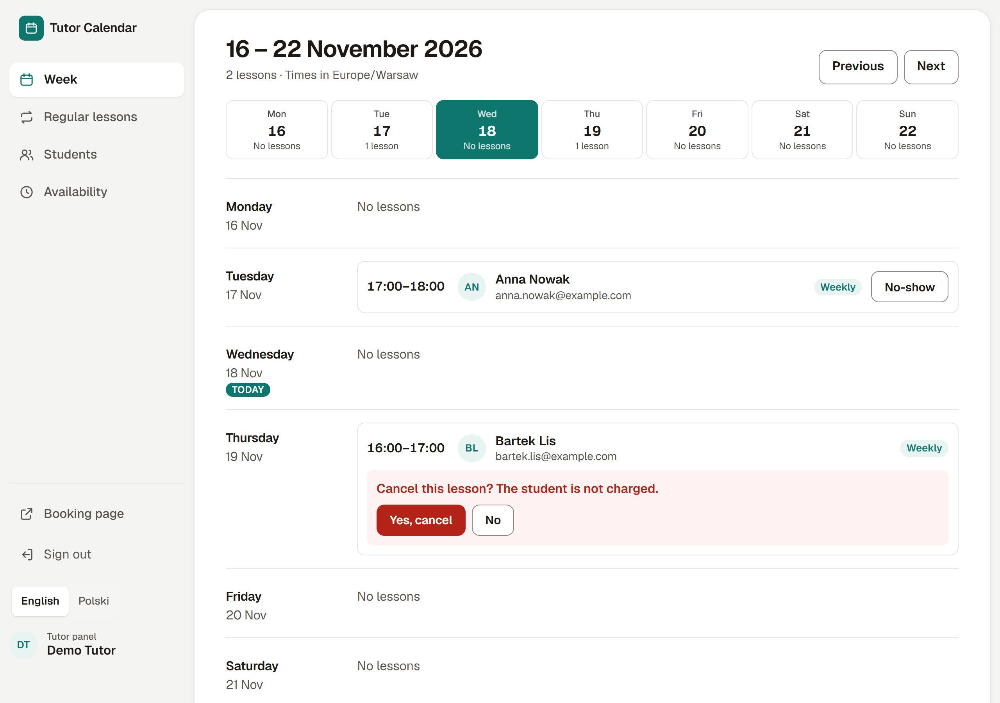
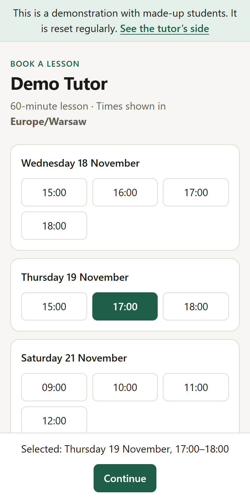
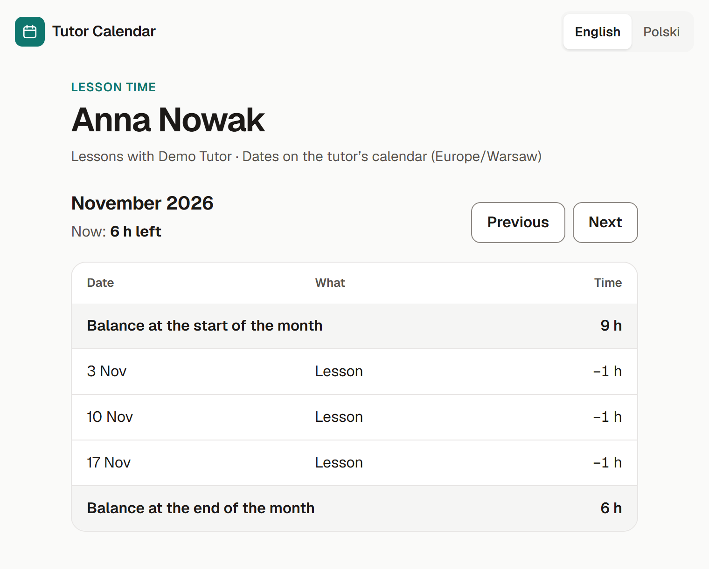
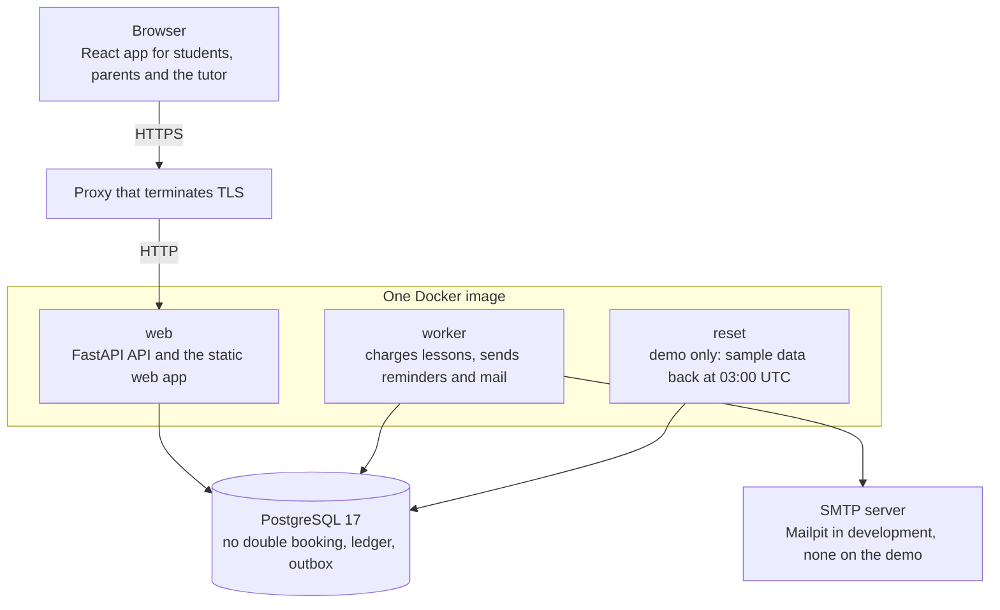
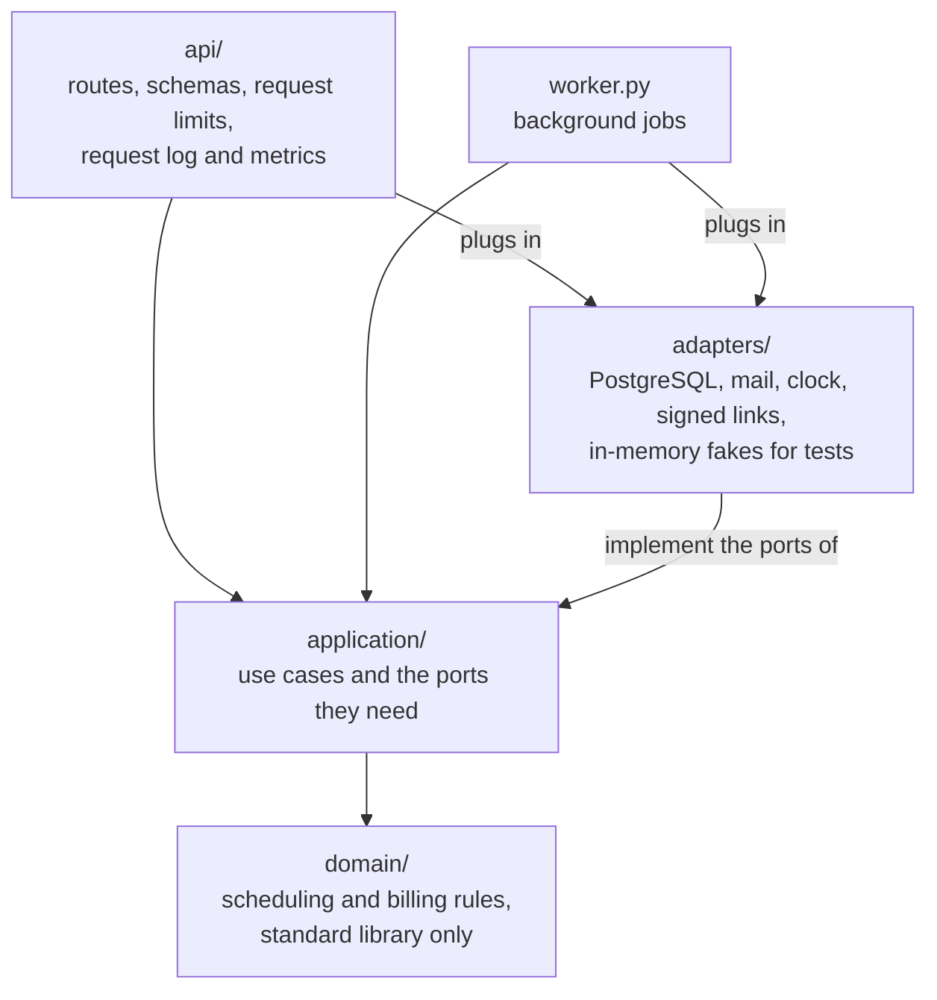

# Tutor Calendar

A booking calendar for independent tutors: fixed weekly lessons, prepaid
packages of hours, a monthly statement for the parent, and a cancellation
policy that is enforced rather than argued about.

General-purpose booking tools handle one-off appointments well. A tutor's week
looks different: the same students at the same times, paid for in blocks, with
"can we move Thursday?" as the most common request. This project is built
around that workflow.

> **Status: all six stages of the [roadmap](#roadmap) are built, and a demo is running.**
> A visitor can book a lesson and cancel it with a link. A tutor can sign in, see
> their week, change their hours, cancel lessons, set up weekly lessons and keep
> track of prepaid lesson time, with a statement to share with the parent. A
> worker sends confirmations and reminders. The interface is in English and
> Polish. See [what is not done](#what-is-not-done).

<p>
  
</p>
<p>
  
  
</p>

The tutor's week, the booking page on a phone, and the statement a parent opens
from a link.

## Try it

**Live demo: <https://tutor.mikrus.dev>**

It opens on the booking page of a made-up tutor. The banner at the top leads to
the tutor's side, where one button opens the panel without an account. Book,
cancel and change whatever you like: the sample data is put back every night at
03:00 UTC, and the demo sends no e-mail.

To run the same thing yourself with Docker, one command starts everything with
a few weeks of sample data:

```bash
docker compose up --build
```

Then open <http://localhost:8000>. The banner at the top leads to the tutor's
side, where one button opens the demo tutor's panel. Mail the application sends
is caught by Mailpit at <http://localhost:8025>.

## What is interesting here

**A slot cannot be booked twice, and a test tries hard to do it.** The naive
"check that the time is free, then insert" passes every ordinary test and fails
in production: with the protection removed, 22 to 24 of 25 simultaneous
requests for one slot got through. Here the database refuses overlapping
bookings with an exclusion constraint, and a test fires 25 requests at one slot
through the whole stack and expects exactly one `201`. A longer stress test
then turned up a deadlock that the first version mishandled.
[ADR 0003](docs/adr/0003-no-double-booking.md) tells that story.

**A lost response does not cost anyone their lesson.** Booking requests carry
an idempotency key, so a retry after a timeout returns the booking the first
attempt made. The page relies on that to retry failed requests on its own.
[ADR 0004](docs/adr/0004-idempotent-booking-requests.md) covers the design and
its one known gap.

**Money that cannot be quietly edited, and mail that cannot be lost.** Prepaid
lesson time is a ledger: entries are only ever added, a database trigger refuses
to change or delete one, and a unique constraint means a lesson is charged at
most once however many workers try. E-mail is queued in the same transaction as
the booking that caused it and delivered by a worker, so there is never a
booking without a confirmation on its way, or a confirmation for a booking that
was rolled back. [ADR 0007](docs/adr/0007-ledger-and-outbox.md) explains both,
and why delivery is "at least once" on purpose.

**Weekly lessons are just lessons.** "Tuesdays at 17:00 for ten weeks" is laid
out into ordinary bookings when it is created, so the constraint that prevents
double booking, the slot list and cancellation all cover a series without a
second code path. A cancelled lesson gives its time back, whether it is charged
depends on the tutor's policy, and a student and a tutor cancelling the same
lesson at once cannot both win.
[ADR 0006](docs/adr/0006-lesson-states-cancellation-and-series.md) weighs this
against expanding series on read.

**Sign-in without passwords, and without the usual holes.** Tutors sign in with
a single-use link. Tokens are stored only as digests, the link's token never
reaches a server log, the session cookie cannot be read by scripts, and asking
for a link does not reveal who has an account. A link opened in twelve browsers
at once signs in exactly one. [ADR 0005](docs/adr/0005-sign-in-by-email-link.md)
goes through each choice and what is still missing.

**No e-mail address in any address.** A student used to be their e-mail
address, which put it in the path of every request about them, and so in every
access log on the way. Students now have an id, given to them in the same
transaction as their first booking, and a migration enrols everyone who was
there before. [ADR 0010](docs/adr/0010-students-get-an-id.md) says why the id
is a row and not an encrypted address, and what still names students by
address.

**A loop cannot run up a bill.** Asking for sign-in links, booking and the API
as a whole each have a limit per visitor, counted as a token bucket in the
process. The interesting part is who counts as one visitor: behind a proxy
every connection comes from the proxy, a header naming the real address can be
written by anyone who reaches the process directly, and one home has 2^64 IPv6
addresses to choose from.
[ADR 0009](docs/adr/0009-request-limits-in-the-process.md) says what was done
about each, and where the demo's limit can still be walked around.

**It can say how it is doing without saying who was there.** Every process
writes its log as JSON lines, and every line written for a request carries
that request's id, which also goes back to the caller. A request's line keeps
the student's id and never has an address, a token or a query string in it.
Liveness and readiness are separate questions, and readiness means the
database has this version's migrations, not just that it answers. Metrics
count bookings made, lost to someone quicker and repeated, and say how far
behind the worker is, read from the database so that a dead worker still shows
up. The use cases log and count nothing themselves, and a test keeps it so.
[ADR 0011](docs/adr/0011-logs-readiness-and-metrics.md) explains why this is a
Prometheus endpoint behind a token and not OpenTelemetry, and what it leaves
out.

**Fakes that cannot drift from the real thing.** Fast tests run against
in-memory repositories. Each port has one set of contract tests that runs
against both the fake and PostgreSQL, so the fake cannot quietly become more
forgiving than the database. See [`tests/contract`](backend/tests/contract).

**Time is modelled, not formatted.** A recurring rule ("Tuesdays 17:00-19:00")
is a wall-clock fact in the tutor's zone; a lesson is a UTC instant. The slot
generator converts between the two and has an explicit policy for the two
nights a year when a local time does not exist or happens twice.
[ADR 0002](docs/adr/0002-time-model.md) explains the policy.

**The tests go looking for trouble.** Besides hand-written cases for each DST
rule, property-based tests generate random schedules in every IANA time zone
and assert that slots never overlap, last exactly one lesson and stay on the
tutor's grid. Random dates almost never land on a clock change, so the
generators are biased towards them; removing any of the three DST safeguards in
the code makes the suite fail.
See [`test_slots_properties.py`](backend/tests/unit/test_slots_properties.py).

**The architecture is enforced by a test.** The domain is plain Python with no
framework imports, use cases depend on ports, and
[`test_architecture.py`](backend/tests/unit/test_architecture.py) fails the
build if an inner layer imports an outer one.
[ADR 0001](docs/adr/0001-hexagonal-modular-monolith.md) has the reasoning.

**Checked for accessibility on every commit.** Each screen goes through
axe-core in the states where things go wrong, and colour contrast is computed
from the design tokens for both themes, so a colour that is too pale fails the
build. [docs/accessibility.md](docs/accessibility.md) lists what was found and,
more to the point, what has not been checked: nobody has used it with a screen
reader yet.

**Numbers with their caveats.** A load test fires requests at the running API
and then asks the database what was stored, so a fast run that double-booked
would count as a failure. It found a quadratic step in listing slots, since
replaced. [docs/load-test.md](docs/load-test.md) has the figures and says
plainly what they do not show.

**One API contract, checked at compile time.** The frontend's types are
generated from the backend's OpenAPI document, and CI fails if the committed
contract is out of date.

## Architecture

One image runs as three processes over one PostgreSQL database. The web
process serves both the API and the built web app, so everything is at one
address. The worker turns finished lessons into ledger entries and delivers the
mail that bookings put in the outbox. On the hosted demo a third process puts
the sample data back every night.



Inside the backend, dependencies point inwards. The API and the worker are the
two places where adapters are plugged into the use cases.



## Stack

| | |
|---|---|
| Backend | Python 3.12, FastAPI, SQLAlchemy 2 (async), Alembic, PostgreSQL 17 |
| Frontend | React 19, TypeScript, Vite, TanStack Query |
| Tests | pytest, Hypothesis, Vitest, Testing Library |
| Tooling | uv, pnpm, Ruff, mypy (strict), ESLint, GitHub Actions |

## Develop it

You need [uv](https://docs.astral.sh/uv/), [pnpm](https://pnpm.io/) and, for
the database, Docker.

```bash
docker compose up -d db
```

```bash
cd backend && uv sync && uv run alembic upgrade head && uv run python -m tutor_calendar.demo && uv run uvicorn tutor_calendar.api.main:app --reload
```

```bash
cd frontend && pnpm install && pnpm dev
```

A third process charges finished lessons and sends e-mail. Bookings work
without it, but nothing is charged and no mail goes out:

```bash
cd backend && uv run python -m tutor_calendar.worker
```

Open <http://localhost:5173> for the demo tutor's booking page. The API
documents itself at <http://localhost:8000/docs>.

To see the tutor panel, go to <http://localhost:5173/panel> and ask for a
sign-in link for `demo@example.com`. With no mail server configured the worker
writes each message to its output, link included. The worker's output is JSON
lines; `TC_LOG_FORMAT=text` in `backend/.env` makes the message readable.

Links for managing a booking and for reading a statement are signed with
`TC_SECRET_KEY`. Without it the API makes up a key at start and says so, those
links stop working when it restarts, and the worker sends no reminders. See
`backend/.env.example`.

The second command migrates the database and stores a demo tutor, whose
booking page is the one the frontend opens.

[docs/deployment.md](docs/deployment.md) describes the image, the two
processes, every setting, and what to do before pointing real students at it.

## Test it

```bash
cd backend && uv run pytest
```

```bash
cd frontend && pnpm test
```

Tests marked `integration` need the database from `docker compose up -d db`.
They create and migrate a database of their own, `tutor_calendar_test`, and
leave development data alone. Without PostgreSQL they are skipped locally and
fail in CI.

After changing the API, regenerate the contract and the frontend types:

```bash
cd backend && uv run python -m tutor_calendar.api.export_openapi ../frontend/openapi.json && cd ../frontend && pnpm gen:api
```

## Layout

```
backend/src/tutor_calendar/
  domain/        rules and value objects; imports nothing but the standard library
  application/   use cases and the ports they need
  adapters/      implementations of ports: PostgreSQL, in-memory fakes, clock
  api/           FastAPI routes, schemas and the composition root
  web.py         the web process as the image runs it
  worker.py      the background process: charges lessons, queues reminders, sends mail
  logs.py        the one log format every process writes
backend/scripts/ the load test
backend/tests/
  unit/          domain, use cases, the architecture rule
  contract/      what a repository must do, run against PostgreSQL and the fake
  api/           HTTP behaviour, with fakes behind it
  integration/   the schema and concurrent bookings, against PostgreSQL
frontend/src/
  api/           generated types and a thin client
  ui/            components that know nothing about tutors: Button, TextField, Notice
  features/      booking, auth, panel and billing: one folder per user-facing feature
docs/            accessibility, load test and deployment notes, screenshots
docs/adr/        architecture decision records
```

## Roadmap

1. **Scheduling core and walking skeleton** - done.
2. **Booking a single lesson**: exclusion constraint against double booking, a
   concurrency test, idempotent requests, the public booking flow - done.
3. **Tutor panel**: sign-in by e-mail link, week view, editing availability, the
   start of a component library - done.
4. **Recurring lessons** with exceptions, the lesson state machine, cancellation
   policy - done.
5. **Packages of hours** as an append-only ledger, the parent's statement,
   reminders through a transactional outbox - done.
6. **Accessibility audit, demo data, load-test numbers**, Polish interface,
   one deployable image, a hosted demo - done.

## What is not done

Said here so that nobody has to find out by trying:

- **The demo runs on one small server with no backups, and nobody is told when
  it breaks.** It is `docker-compose.demo.yml`, as
  [docs/deployment.md](docs/deployment.md) describes, and it may be down. It
  writes structured logs and serves metrics, but nothing collects either: no
  alerts, no dashboard, no traces, and the logs stay on the server.
- **Nobody has used it with a screen reader**, and nobody but its author has
  used it at all.
- **The request limits can be walked around** by someone who reaches the demo's
  server directly instead of through its proxy, and nothing bounds the sign-in
  links sent to one address from many. Close both before connecting a mail
  server.
- **Tutors cannot sign up.** The demo tutor is the only one, unless a row is
  added to the database.
- **A student cannot change their e-mail address.** They have an id now, but
  bookings and the ledger still find them by address.
- **A weekly series has an end** (at most 52 lessons) and its time cannot be
  changed, only ended and started again.
- **E-mail is in English only**, and old messages, tokens and sessions are
  never cleaned up.
- **The worker's log is not free of addresses.** Without a mail server it
  writes out each message it would have sent, which is how the demo runs.

Deliberately out of scope: online payments, Google Calendar sync, SMS, schools
with several teachers, a native mobile app.

## License

[MIT](LICENSE).
